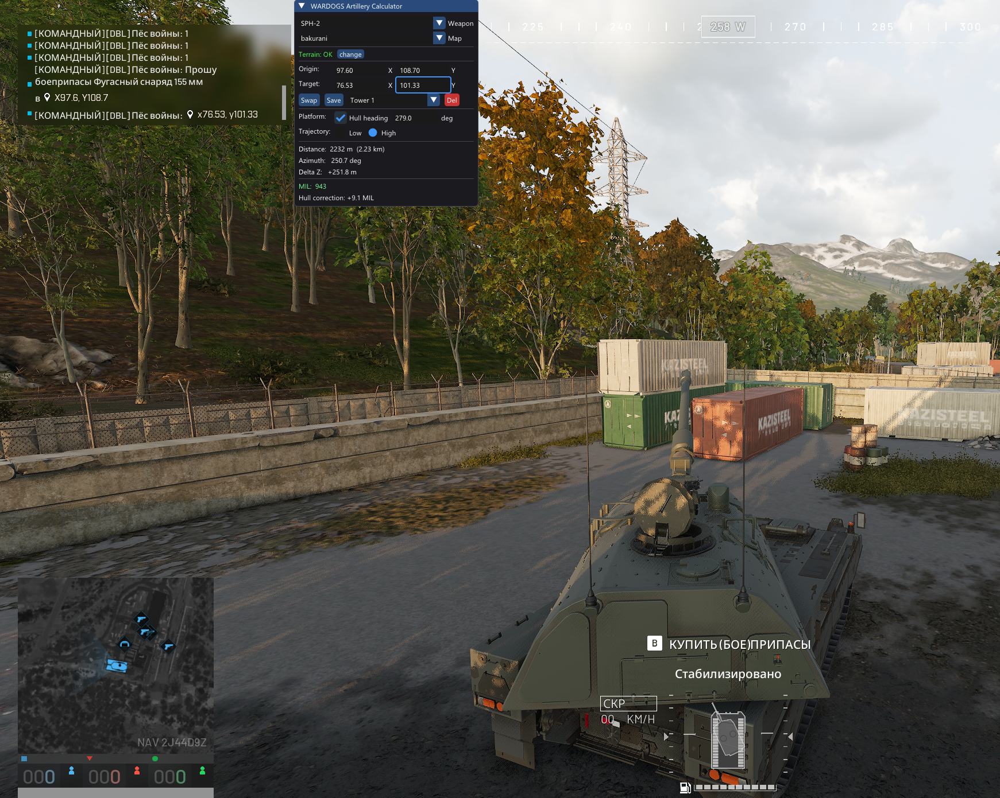
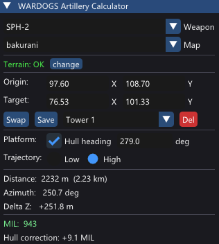

[](https://github.com/pdx15/wardogs-calculator-overlay/releases)
[](https://github.com/pdx15/wardogs-calculator-overlay/releases)
[](https://github.com/pdx15/wardogs-calculator-overlay)
[](https://github.com/pdx15/wardogs-calculator-overlay#%D0%B4%D0%BE%D0%BD%D0%B0%D1%82donate)

**English** | [Русский](README_RU.md)

# WARDOGS Artillery Calculator - Overlay

Lightweight C++ desktop overlay for WARDOGS artillery calculations.
Displays MIL, azimuth, and distance with full terrain height correction.

Download for windows [Releases](https://github.com/pdx15/wardogs-calculator-overlay/releases)

### Interface Preview

<table>
  <tr>
    <th width="72%">In game</th>
    <th width="28%">UI</th>
  </tr>
  <tr>
    <td align="center">
      
    </td>
    <td align="center">
      
    </td>
  </tr>
</table>

## Features

- **Ballistic tables** — L81 Mortar and SPH-2 (low + high arc)
- **RK4 terrain correction** — numerical physics solver matching Apollyon
- **Hull heading correction** — SPH-2 platform model (pitch 5°)
- **Save/Load targets** — per-map target bookmarks
- **Always-on-top overlay** — system tray for show/hide and exit
- **System tray icon** — left-click toggles overlay, right-click for menu

## Build

Run `build.bat` and select your compiler from the menu. CMake, SDL3 and ImGui are downloaded and built automatically — no manual dependencies.

### Terrain data

For terrain height correction, download and place the full `wardogs-data` folder next to `calculator.exe`:

```
wardogs-data/
├── data/maps/
│   ├── bakurani/terrain.json
│   ├── ozeti/terrain.json
│   └── zestafona/terrain.json
└── assets/maps/
    ├── kavkazi/heightmap.png
    ├── europe/heightmap.png
    └── north-america/heightmap.png
```

Download [wardogs-data](https://drive.google.com/file/d/1vN_mXTHkiWVPnv3evhWjevvLWi_dmDWB/view?usp=sharing)

Without `wardogs-data` the calculator still works — MIL is computed from ballistic tables, but without terrain height correction (Delta Z = 0).

### Loading terrain

If `wardogs-data` is placed next to `calculator.exe`, terrain loads automatically on startup. Otherwise, enter the path manually and click **Load**.

## Usage

1. Select weapon and map
2. Enter artillery (origin) and target coordinates (game units, decimals allowed)
3. MIL is calculated automatically when coordinates change
4. **Save** — bookmark the current target with a name (per-map)
5. **Load** — select a previously saved target
6. For SPH-2: enable **Hull heading** and set the vehicle heading for platform correction

## Tray

| Action | Effect |
|--------|--------|
| F5 (default) | Toggle show / hide overlay |
| Tray icon left-click | Toggle show / hide |
| Tray icon right-click | Exit |

The hotkey can be reassigned in the Settings panel — click the current hotkey button and press any key. Press Esc to disable.

Drag the window by its title bar to move it.

## Донат/Donate

Если вы хотите оставить чаевые, то можно это сделать по ссылке ниже или через QR-код:

[](https://pay.cloudtips.ru/p/1569852d)

**Оставить чаевые через CloudTips:** https://pay.cloudtips.ru/p/1569852d

| Crypto Currency | Network | Wallet ID |
|--------------|------|----------------|
| **USDT**     | TRC20 | `TGm951N5TpuBKayeAP6vL8wAdB9vEvdMyo` |
| **USDT**     | ERC20 | `0xd938130bce0C9A6a8F83dDe4fEAF6A86847c148B` |
| **BTC**      |    | `c1qhg00wd03fnhdpwhg8fa4a3tpshhmsf0uslw8nf` |

---
